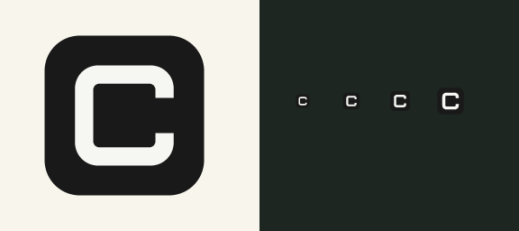

# 晒衣绳 · Clothesline for Windows

一个把截图夹在桌面晒衣绳上的本地桌面应用。面向 Windows 10 / 11，当前为 0.1.3 MVP；借鉴晒衣绳生活隐喻，不包含其他应用的素材或代码。



## 运行与打包

需要 Node.js 22.12 或更新的版本，以及 npm。首次安装需联网下载 Electron；项目的 `postinstall` 会安装对应的桌面运行程序。如果使用了 `--ignore-scripts`，之后需执行 `node node_modules/electron/install.js`。

```powershell
cd clothesline
npm ci
npm start
```

退出：系统托盘右键 → 退出。托盘单击或双击可以重新显示绳子；右键打开菜单，可截图、设置或隐藏绳子。截图过程中单击不会让绳子进入捕获画面。默认区域截图快捷键 `Ctrl+Shift+2`，冲突时可在设置中修改。

```powershell
npm run check
npm test
npm run pack   # release/win-unpacked/Clothesline.exe
npm run dist   # release/ 下生成 NSIS 安装程序和 portable 便携程序
node scripts/verify-release.js # 对比打包源码，检查文件格式，生成 SHA256SUMS.txt
```

打包目标为 Windows x64。安装包未签名；后续公开分发应设置自己的代码签名证书。此项目不自动发布，也不自动上传截图。首次体验可直接运行 `release/Clothesline-Portable-0.1.3-x64.exe`，不需要安装 Node.js。

0.1.3 更新：应用图标改为黑白几何字母 C。Windows 安装包、窗口和托盘共用多尺寸 ICO，包含 16 / 20 / 24 / 32 / 40 / 48 / 64 / 128 / 256 像素。`src/icon.svg` 是可编辑矢量稿；`npm run icons` 可无依赖重新生成全部素材。

0.1.2 修复：托盘图标支持单击显示绳子，保留双击和右键菜单；悬停提示说明操作方式。重复单击不会把绳子隐藏，截图进行中保持绳子隐藏。

0.1.1 修复：关闭截图蒙层、预览或设置时不再读取已销毁窗口的 `webContents`；窗口 ID 在创建时缓存。关闭窗口导致的页面加载中断不会误弹加载失败提示，取消关闭时仍正常提示实际加载错误。取消截图后迟到的捕获结果会丢弃，旧会话的关闭事件不会结束新会话。增加真实窗口连续关闭、强制销毁、延迟显示、取消截图与多窗口正常退出的回归检查。

## 核心操作

- **区域截图**：按快捷键或点击「区域」，在冻结画面上拖动，松开后自动挂绳；`Esc` 取消。当前一次只在设置选定的显示器内选择。
- **全屏截图**：截取设置选定的显示器。默认主显示器。
- **窗口截图**：在窗口列表点击目标窗口。截图前隐藏应用自身窗口；受 DRM / 系统保护的内容可能是黑屏，最小化窗口请先恢复。窗口缩略图由 Electron 捕获，超出最大显示器尺寸的窗口可能缩小，不承诺所有窗口原生分辨率。
- **整理**：点击缩略图打开预览；按住缩略图下方 `↔` 左右拖动排序；绳子挂满后可横向滚动。最多同时挂 80 张。
- **标注**：画笔、箭头、文字、高亮、马赛克；支持撤销、重做。文字先在工具栏输入，再点击图片。点击「保存标注」后再复制或分享。恢复原图需要确认，旧的已保存标注文件仍保留。关闭有未保存标注的预览会提示。
- **分享**：按住缩略图或预览页上的 `↗` 按钮，拖到接受文件拖放的应用。传递 PNG 文件；微信、QQ、浏览器的接收行为取决于各应用。也可以右键 → 复制图片，再粘贴。
- **右键菜单**：预览 / 标注、复制、另存为、固定、收纳、删除。
- **收衣服**：把未固定截图移到收纳箱，文件仍保留；收纳箱中点击「挂回」恢复。固定截图继续留在绳子上。
- **删除**：确认后把该截图目录连同原图、标注版本移入系统回收站。
- **设置**：全局区域快捷键、显示器、顶部 / 底部、置顶、自动复制、另存为默认目录、开机启动。开机启动只在安装或打包后可启用，默认关闭。

所有截图先自动保存在应用数据目录，以保证重启后仍可使用；「默认保存目录」控制另存为对话框，不会自动向该目录写入每一张截图。

## 技术栈与架构

Electron + 原生 JavaScript / HTML / CSS，运行时无第三方界面库，开发依赖只有 Electron 和 electron-builder。无需 .NET、Rust、PowerShell 截图辅助程序或原生模块编译。

Electron 提供 Windows 桌面捕获、透明置顶窗口、全局快捷键、图片剪贴板、系统托盘和原生文件拖放。相较 WPF / Tauri，其安装体积和进程内存开销较大；此版本优先让截图与桌面交互的完整流程可维护、可验证。

```text
clothesline/
├─ src/
│  ├─ main.js       主进程：窗口、截图、托盘、快捷键、IPC、文件操作
│  ├─ core.js       设置校验、DPI 裁剪、索引持久化与恢复
│  ├─ preload.js    contextBridge 能力白名单
│  ├─ icon.svg/.png/.ico 原创图标与多尺寸 Windows 图标
│  └─ ui/
│     ├─ index.html 本地页面与 CSP
│     ├─ app.js     晒衣绳 / 预览标注 / 区域与窗口选择 / 设置
│     └─ style.css  透明绳子、木夹、纸卡视觉
├─ scripts/
│  ├─ check.js      JavaScript 语法检查
│  ├─ png.js        无依赖 PNG 图标与测试图生成器
│  ├─ make-icons.js 无依赖矢量、PNG 与多尺寸 ICO 生成器
│  ├─ lifecycle-regression.js 真实窗口关闭与退出回归
│  ├─ verify-release.js 打包内容与校验和验证
│  └─ smoke.js      Electron 实机集成验证
├─ design/icon-preview.png 图标与托盘尺寸预览
├─ test/core.test.js
├─ package.json
├─ package-lock.json
└─ LICENSE         MIT
```

主进程保有文件路径与系统权限。渲染进程开启 `sandbox`、`contextIsolation`，关闭 `nodeIntegration`。预加载只开放指定能力；主进程进一步按窗口角色校验 IPC。所有页面为本地文件，使用 CSP 限制脚本、网络和嵌入内容，禁止页面导航和弹出窗口。PNG 标注校验格式、长度与尺寸。外部分享使用系统文件拖放，不读取其他应用内容。

截图过程中先隐藏应用窗口，再捕获屏幕。区域选择使用捕获的静止画面，选区从 CSS 坐标按实际图像尺寸转换成像素坐标，避免混合缩放比例导致选区错位。屏幕更换、断开或分辨率变化时重新定位绳子。

## 数据与恢复

数据默认位于 `%APPDATA%/clothesline-desktop/`（以 Electron 的实际 `userData` 路径为准，可从设置 → 查看本地数据打开）。

```text
state.json             当前索引及设置
state.json.bak         上一次成功保存的索引
captures/<UUID>/
  original.png         始终保留的原图
  edit-<timestamp>.png  每次保存的标注版本
```

索引以临时文件写入，再重命名替换；损坏索引在恢复前复制为 `.damaged-<timestamp>`，尝试恢复备份。若两份索引都无法读取，原始 PNG 仍保留在 `captures` 中，界面会提示。当前没有自动孤立图片重建索引功能，可手动从目录取回。

## 验证与后续

```powershell
.\node_modules\.bin\electron.cmd . --smoke
```

集成检查每次使用独立的 `test-results/smoke-data/run-<timestamp>` 数据目录及合成图片，验证真实窗口 / preload / IPC / Canvas 标注 / 原图保留 / 屏幕捕获能力，输出页面截图和 `test-results/smoke.json`。桌面捕获画面只在内存中检查，不保存用户桌面画面。退出后注销快捷键。

仍需人工验收：混合 DPI 的多显示器、跨应用实际文件拖拽、受保护窗口、安装后的开机启动、长时间运行的性能。当前只有一根绳子；多绳子、搜索、分类、自动更新与签名分发留到后续。

官方接口参考：[desktopCapturer](https://www.electronjs.org/docs/latest/api/desktop-capturer)、[原生文件拖放](https://www.electronjs.org/docs/latest/tutorial/native-file-drag-drop/)、[透明窗口与鼠标穿透](https://www.electronjs.org/docs/latest/api/browser-window)、[安全配置](https://www.electronjs.org/docs/latest/tutorial/security/)。

开发依赖审计：2026-10-10 查询 npm 安全公告，打包器的 `@electron/get → global-agent → roarr → sprintf-js` 链报告 8 项中等风险（同一源问题的传递影响），没有高危或严重项。上游 [GHSA-hp3w-g68c-fv3c](https://github.com/advisories/GHSA-hp3w-g68c-fv3c) 暂无修复版本；这些依赖只用于开发与打包，不放入应用的运行依赖。后续升级打包器时应重新运行 `npm audit`；未执行可能改变打包行为的 `npm audit fix --force`。
