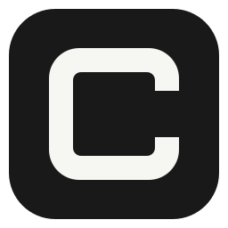
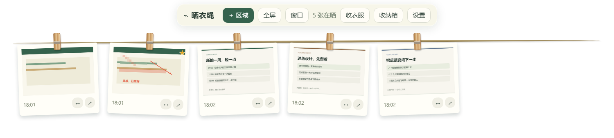
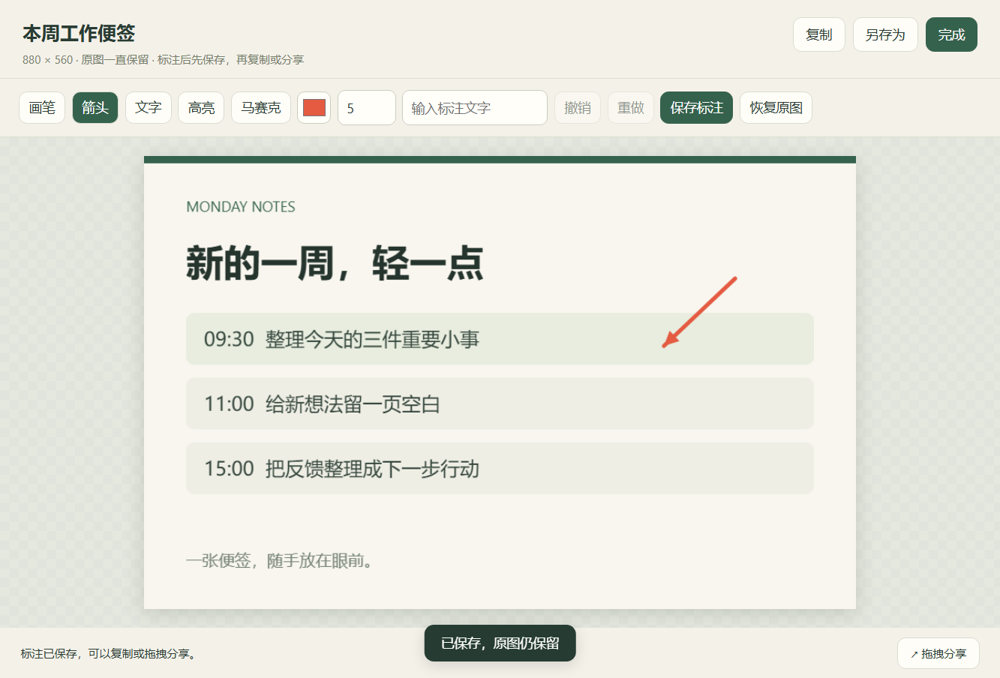

<p align="center"></p>

# 晒衣绳 · Clothesline

**截图，挂起来。**

把截图夹在桌面的一根晒衣绳上，需要的时候随手打开。适合留住参考图、对照修改、标记问题，再复制或拖给别人。

Windows 10 / 11 · x64 · 免费开源 · 当前为 **v0.1.3 预览版**

## 下载就能用

**[下载 Windows 安装版](https://github.com/Lucky-BQR/clothesline/releases/download/v0.1.3/Clothesline-Setup-0.1.3-x64.exe)**　|　**[下载免安装便携版](https://github.com/Lucky-BQR/clothesline/releases/download/v0.1.3/Clothesline-Portable-0.1.3-x64.exe)**

| 版本 | 怎么用 |
| --- | --- |
| 安装版，推荐日常使用 | 下载 `.exe`，按提示安装，从桌面快捷方式启动。 |
| 便携版，适合先试试 | 把 `.exe` 放进自己的文件夹，双击运行。截图和设置仍保存到本机应用数据目录。 |

两种版本都约 106 MB，已包含运行环境，**不用安装 Node.js、npm 或 .NET**。

安装包目前未做代码签名，Windows 可能提示未知发布者。请核对下载来源；需要校验文件时，可使用 [SHA256SUMS.txt](https://github.com/Lucky-BQR/clothesline/releases/download/v0.1.3/SHA256SUMS.txt)。[查看所有版本及更新说明](https://github.com/Lucky-BQR/clothesline/releases)。

## 三步开始用

1. **打开晒衣绳。** 桌面顶部会出现工具栏和绳子，右下角系统托盘会出现 C 图标。单击托盘图标可以重新显示绳子。
2. **按 `Ctrl + Shift + 2` 截图。** 拖出一个区域，松开鼠标，截图自动挂上去。按 `Esc` 取消。工具栏也支持「全屏」和「窗口」。
3. **点击图片，标注或分享。** 画箭头、写文字、遮住敏感内容；点「保存标注」，再复制粘贴，或按住 `↗` 拖到接受图片文件的应用。



*实际应用界面。图中便签为虚构示例，不含个人资料。*

## 需要的时候，截图就在眼前

- **写东西时留参考：** 把资料中的一段话或参考图挂起来，边看边写。
- **讨论修改时画重点：** 打开截图，圈出问题或画箭头，再发给对方。
- **临时保留灵感：** 把值得留下的页面截图放在桌面，不必来回找文件。
- **忙完后收衣服：** 一键把未固定的图片放进收纳箱，以后还能挂回。



*箭头已通过应用的标注工具绘制并保存，原图仍保留。*

## 常用操作

| 想做什么 | 操作 |
| --- | --- |
| 区域截图 | `Ctrl + Shift + 2`，或工具栏「区域」。 |
| 全屏 / 窗口截图 | 工具栏「全屏」/「窗口」，窗口截图需要选择目标窗口。 |
| 放大、标注 | 点击缩略图。支持画笔、箭头、文字、高亮、马赛克、撤销与重做。文字先输入，再点击图片。 |
| 复制 / 保存文件 | 右键图片 →「复制图片」/「另存为」，预览页也有对应按钮。 |
| 拖拽分享 | 按住 `↗` 拖到接受文件拖放的应用。 |
| 调整顺序 | 按住卡片下方 `↔`，左右拖动；图片多时可横向滚动。 |
| 留住某张图 | 右键 →「固定」，收衣服时它会继续留在绳子上。 |
| 收纳 / 恢复 | 点「收衣服」，未固定图片进入收纳箱；在收纳箱点「挂回」。 |
| 删除 | 右键 →「删除」，确认后原图和标注版本一起进入系统回收站。 |
| 设置 / 退出 | 工具栏「设置」；退出请右键系统托盘 C 图标 →「退出」。 |

**标注后先点「保存标注」，再复制或分享。** 关闭未保存的预览会提示；恢复原图不会删除旧的已保存标注文件。

## 第一次使用可能会遇到的问题

**绳子不见了？**

点击右下角托盘 C 图标。找不到时，先点 Windows 托盘的 `^` 展开隐藏图标；右键 C 图标也能打开显示、截图和设置菜单。

**截图快捷键没反应？**

可能被其他应用占用。进入「设置」改一个快捷键，例如 `CommandOrControl+Alt+2`，然后保存。

**截图存在哪里？**

默认保存在 `%APPDATA%\clothesline-desktop\`，可在「设置 → 查看本地数据」打开。原图和已保存的标注版本都会保留，重启后仍能查看。「默认保存目录」只控制“另存为”对话框的起始位置，每张截图仍先保存到应用数据目录。

**截图会上传吗？**

应用把截图和设置保存在本机，没有云同步或截图上传功能。主动粘贴或拖到其他应用后，由接收方处理文件。

**窗口截图是黑色的，或拖到微信 / QQ 没成功？**

受保护内容可能无法捕获，最小化窗口请先恢复，也可以改用区域截图。不同版本的聊天软件、浏览器对文件拖放的支持不同，拖不进去时可用「复制图片」再粘贴。

**能换位置、显示器或开机启动吗？**

在设置中选择显示器、顶部 / 底部、是否置顶、自动复制和开机启动。开机启动默认关闭，在安装或打包版本中可启用。

## 预览版的范围

目前只有一根绳子，最多同时挂 80 张；区域截图在选定显示器内完成。暂未提供 OCR、搜索、多绳子、云同步或自动更新。窗口捕获可能受系统保护和分辨率限制。

混合 DPI 多显示器、跨应用拖拽、开机启动和长时间运行仍需要更多实际使用反馈。如果出错，请提供 Windows 版本、应用版本、复现步骤和错误文字，并遮住截图中的个人资料。

**[报告问题](https://github.com/Lucky-BQR/clothesline/issues/new?template=bug_report.yml)**　|　**[提出建议](https://github.com/Lucky-BQR/clothesline/issues/new?template=feature_request.yml)**

## 开发与宣传素材

[开发文档](docs/development.md)包含项目结构、运行、测试、打包和数据恢复说明。[宣传素材包](design/marketing/README.md)提供海报、真实界面截图和可直接使用的介绍文案。

开发运行需要 Node.js 22.12 或更新版本：

```powershell
git clone https://github.com/Lucky-BQR/clothesline.git
cd clothesline
npm ci
npm start
```

设计受到 macOS [Tendedero](https://github.com/alejandrobujan/tendedero) 的晒衣绳隐喻启发，本项目为独立的 Windows 实现。代码采用 [MIT 许可证](LICENSE)。
