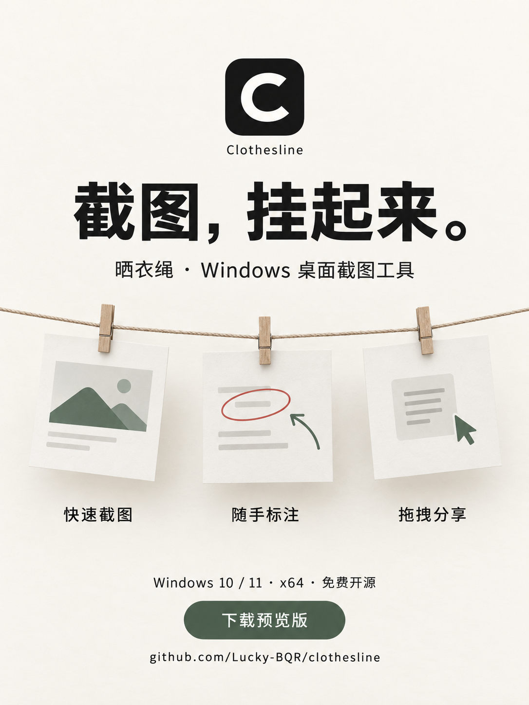

# 晒衣绳宣传素材

项目入口：[github.com/Lucky-BQR/clothesline](https://github.com/Lucky-BQR/clothesline)

下载入口：[v0.1.3 Windows 预览版](https://github.com/Lucky-BQR/clothesline/releases/tag/v0.1.3)

## 海报

[下载竖版 PNG 原图](poster-portrait.png) · 1086 × 1448 · 适合聊天分享、社区帖子和产品介绍。

海报中的纸卡是功能隐喻，不代表应用界面。实际界面见下面的截图。

## 实际界面与图标

- [桌面晒衣绳](../../docs/images/clothesline-rope.png)：真实应用界面，使用虚构便签展示。
- [预览与标注](../../docs/images/clothesline-editor.png)：实际通过标注工具绘制、保存箭头后的界面。
- [SVG 图标](../../src/icon.svg) · [PNG 图标](../../src/icon.png) · [Windows ICO](../../src/icon.ico)：应用使用的黑白几何 C 原始素材。

分享时请使用这些示例截图，不要无意上传自己的工作资料或截图数据目录。

## 可直接使用的介绍文案

> 截图，挂起来。
>
> 晒衣绳 Clothesline 是一个免费开源的 Windows 桌面截图工具。按 Ctrl + Shift + 2 截取区域，图片就会挂到桌面的晒衣绳上。点开即可画箭头、写文字、高亮或打马赛克，保存后复制或拖拽分享；忙完还能一键收纳。
>
> 适用于 Windows 10 / 11 x64。提供安装版和免安装便携版，下载后就能用。
>
> 当前是 v0.1.3 预览版，欢迎试用和反馈。
> 下载：https://github.com/Lucky-BQR/clothesline/releases/tag/v0.1.3

更短的版本：

> 给桌面挂一根晒衣绳：截图自动挂上去，随手标注、复制和分享。Clothesline，Windows 10 / 11 免费开源截图工具，现已提供安装版和便携版预览。
> https://github.com/Lucky-BQR/clothesline

## 制作说明

海报使用内置 imagegen 生成，并人工检查中文、网址和功能表述；[生成提示词](poster-prompt.txt)保留在仓库中。它是宣传视觉，应用图标则由项目内的矢量几何生成器制作。真实界面截图通过 `--smoke --marketing` 在独立测试目录中生成，只使用合成便签，不导出用户桌面或个人截图。

本目录素材随项目以 [MIT 许可证](../../LICENSE)提供；未执行向社交平台自动发布。
